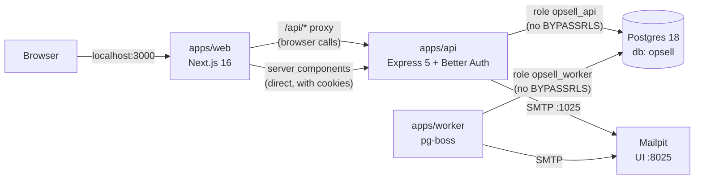
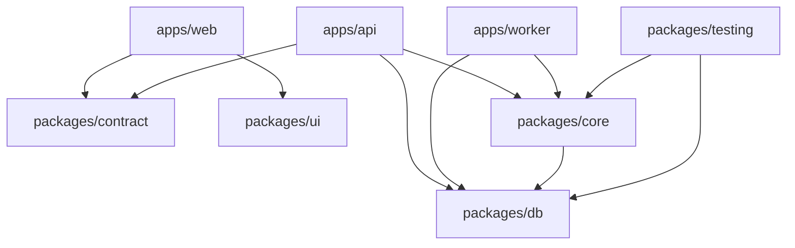

# The walking skeleton

This is a guided tour of the repository as it stands after the walking skeleton (PR #128).
The skeleton does very little on purpose.
An Org Admin signs in with an emailed code and sees their Organization's Locations.
But that one thin slice runs through every layer the product will use: database, Row-Level Security, API, contract, jobs, web app, tests, CI and Docker.
Every later ticket follows the conventions set here.

The [README](../README.md) is the short version.
Domain words (Organization, Location, Org Admin, Role, User) are defined in [GLOSSARY.md](../GLOSSARY.md), and the reasons behind decisions are in [docs/adr](adr).

## 1. The big picture



Three processes run on your machine, and two run in Docker.

| What | Where it runs | Port | Started by |
| --- | --- | --- | --- |
| Postgres 18 | Docker container `opsell-postgres-1` | 5432 | `docker compose` (inside `pnpm dev`) |
| Mailpit (catches all email) | Docker container `opsell-mailpit-1` | 1025 SMTP, 8025 web UI | `docker compose` (inside `pnpm dev`) |
| API (`apps/api`) | Host, `node --watch src/main.ts` | 4000 | `turbo run dev` (inside `pnpm dev`) |
| Worker (`apps/worker`) | Host, `node --watch src/main.ts` | none | `turbo run dev` (inside `pnpm dev`) |
| Web (`apps/web`) | Host, `next dev` | 3000 | `turbo run dev` (inside `pnpm dev`) |

Only the databases and the mail catcher are containerized locally.
The apps run directly on the host so file watching and reloads are fast.
Node runs TypeScript natively (Node 24 type stripping), so in development there is no build step for the API, worker or packages.

## 2. How to run it

### Prerequisites

- Node 24 (`.nvmrc` says `24`).
- pnpm 11 (`corepack enable` picks up `packageManager: pnpm@11.9.0`).
- Docker Desktop running.

### First run

```sh
pnpm install
pnpm dev
```

Then:

1. Open http://localhost:3000. You are redirected to `/sign-in`.
2. Enter `dana@larkspur.example` (Larkspur Bakehouse, 5 Locations) or `riley@juniper.example` (Juniper Coffee, 2 Locations).
3. Open Mailpit at http://localhost:8025 and copy the 6-digit code from the newest email. The code is also in the subject line.
4. Paste the code. You land on `/locations` and see only your own Organization's Locations.

To stop, press `Ctrl+C`.
That stops the API, worker and web app.
Postgres and Mailpit keep running in Docker; stop them with `docker compose down` (add `-v` to also delete the database volume).

### What `pnpm dev` does, step by step

`pnpm dev` runs [`scripts/dev.ts`](../scripts/dev.ts).
Every step is idempotent, so it is safe to re-run at any time.

| Step | Command | What happens |
| --- | --- | --- |
| 1 | copy `.env.example` to `.env` | Only if `.env` is missing. Every process reads the root `.env`. |
| 2 | `docker compose up --detach --wait` | Starts Postgres and Mailpit from [`docker-compose.yml`](../docker-compose.yml) and waits until they are healthy. |
| 3 | `pnpm db:bootstrap` | As the Postgres superuser, creates the roles `opsell_owner`, `opsell_app`, `opsell_api`, `opsell_worker` and the `opsell` database. Prints `Database roles and database are ready.` |
| 4 | `pnpm db:migrate` | As `opsell_owner`, applies the Drizzle migrations in `packages/db/drizzle/`, installs pg-boss in the `pgboss` schema, and grants the app roles access. Prints `Migrations applied.` |
| 5 | `pnpm db:seed` | As `opsell_owner`, inserts the two dev Organizations, their Org Admins and Locations. Prints `Seed applied.` |
| 6 | `pnpm turbo run dev --filter=@opsell/api --filter=@opsell/worker --filter=@opsell/web` | Turbo first runs `@opsell/contract`'s `generate` task (the OpenAPI document and types), then starts the three apps in watch mode. |

You know it is up when the log shows `API listening on :4000`, `Worker started with 0 queues.` and Next.js `Ready`.
Zero queues is expected: no job types are registered yet.

### Environment variables

All local values live in [`.env.example`](../.env.example).

| Variable | Used by | Purpose |
| --- | --- | --- |
| `DATABASE_ADMIN_URL` | bootstrap, test harness | Superuser connection to create roles and databases. |
| `DATABASE_OWNER_URL` | migrate, seed, test scenarios | Owns the tables, so it is not subject to Row-Level Security. |
| `DATABASE_API_URL` | API | Login role without `BYPASSRLS`. |
| `DATABASE_WORKER_URL` | Worker | Login role without `BYPASSRLS`. |
| `SMTP_URL`, `MAIL_FROM` | API, worker | Outgoing mail; Mailpit locally. |
| `BETTER_AUTH_SECRET` | API | Signs sessions; at least 32 characters. |
| `WEB_ORIGIN` | API | The only origin browsers use; Better Auth's base URL. |
| `API_PORT` | API | Defaults to 4000. |
| `API_URL` | Web | Where the Next.js server reaches the API, read at request time. |
| `ANTHROPIC_API_KEY` | API, worker | Optional; not used by any feature yet. |

### Useful URLs while it runs

- http://localhost:3000 - the web app.
- http://localhost:8025 - Mailpit inbox.
- http://localhost:4000/healthz - API liveness, returns `{"ok":true}`.
- http://localhost:4000/api/me - returns `401 unauthorized` until you send a session cookie.

## 3. The repository, package by package

It is a pnpm workspace (`apps/*`, `packages/*`) orchestrated by Turborepo ([`turbo.json`](../turbo.json)).
Workspace packages export their TypeScript source directly (`"exports": "./src/index.ts"`), so there is nothing to build between them in development.



`apps/web` never depends on `packages/db` or `packages/core` at runtime (it lists `@opsell/db` as a dev dependency only so the Playwright test can import the seed fixtures).
This is the rule from ADR 0004: Next.js renders UI and never touches Postgres.

| Path | Role in the system |
| --- | --- |
| `packages/config` | Shared `tsconfig` bases and Biome config. |
| `packages/db` | Drizzle schema, RLS policies, migrations, `withTenant`/`withUser`, and the admin CLIs (bootstrap, migrate, seed). |
| `packages/contract` | Zod schemas, the generated OpenAPI 3.1 document, and the typed `openapi-fetch` client. |
| `packages/core` | Domain functions, ports (Clock, Mailer, Sms, Claude, Jobs), job definitions, and production adapters. |
| `packages/testing` | Vitest harness: database per run, fakes, Scenario builder. |
| `packages/ui` | Claude Design tokens and Tailwind v4 components on Radix. |
| `apps/api` | Express 5 HTTP API with Better Auth. |
| `apps/worker` | pg-boss job runner. |
| `apps/web` | Next.js 16 web app. |
| `prototypes/` | Static HTML prototypes from earlier design work; not part of the build. |

## 4. Stage by stage: what happens in each layer

### Stage 1: Database roles (`packages/db/src/admin/bootstrap.ts`)

Security starts with who is allowed to connect.
Bootstrap creates four roles:

- `opsell_owner` logs in, owns the database and tables, and runs migrations and seeds. Table owners skip RLS, so only admin tooling uses it.
- `opsell_app` is a group role that cannot log in. Migrations grant table access to it by name.
- `opsell_api` and `opsell_worker` log in and are members of `opsell_app`. Neither has `BYPASSRLS` nor owns any table, so RLS applies to every query they run.

The same function is used by `pnpm dev`, CI and the test harness, so all three environments have identical roles.

### Stage 2: Schema and Row-Level Security (`packages/db/src/schema/`, `packages/db/drizzle/`)

Tables are defined with Drizzle in TypeScript, and `drizzle-kit generate` writes SQL migrations to `packages/db/drizzle/`.

- `schema/auth.ts`: `users`, `sessions`, `accounts`, `verifications`, used by Better Auth. Users are global, not owned by one Organization (ADR 0010).
- `schema/tenancy.ts`: `organizations`, `memberships` (a User's Role in one Organization), `locations`.

Every tenant-owned row carries `organization_id`.
Policies compare it to a per-transaction setting:

```sql
nullif(current_setting('app.organization_id', true), '')::uuid
```

If that setting is not set, policies match nothing, so a forgotten tenant context returns empty results instead of another Organization's data.
Migration `0001` also grants table access to `opsell_app` and adds a trigger that makes `organizations.is_demo` immutable (ADR 0005).

### Stage 3: The tenant transaction (`packages/db/src/database.ts`)

`createDatabase(url)` returns three ways in:

- `withTenant(organizationId, userId, fn)` opens a transaction, runs `set_config('app.organization_id', ..., true)` and `set_config('app.user_id', ..., true)` (the `true` makes them transaction-local), and passes `fn` a `TenantTx`.
- `withUser(userId, fn)` sets only the User, so a User can list their own memberships before an Organization is chosen.
- `global` queries with no context, for the global identity tables Better Auth uses.

`TenantTx` is a branded type.
Domain functions take it as their first argument, so calling one outside `withTenant` fails to typecheck (ADR 0011).
Because the settings are transaction-local, they can never leak to the next user of a pooled connection.

### Stage 4: Domain logic and ports (`packages/core`)

`core` holds the business logic shared by the API and the worker.
Today that is small:

- `locations.ts`: `listLocations(tx)` and `getLocation(tx, id)`. They contain no `organization_id` filter; RLS does the scoping.
- `memberships.ts`: `listMembershipsOfUser` (used at sign-in) and `getMembership` (used on every request).
- `jobs.ts`: `defineJob`, `runJob`, and the `jobDefinitions` registry (empty for now).

`ports.ts` defines the seams to the outside world: `Clock`, `Mailer`, `Sms`, `ClaudeClient`, `Jobs`, bundled as `Deps`.
`adapters/` holds the production implementations (system clock, SMTP via nodemailer, the Anthropic SDK, pg-boss), and `startRuntime()` wires them together.
Tests swap in fakes from `packages/testing` through the same `Deps` shape.

### Stage 5: The contract (`packages/contract`)

The API's request and response shapes are Zod schemas in `src/schemas.ts`.
`src/document.ts` builds the OpenAPI 3.1 document from them.
`pnpm generate` writes:

- `packages/contract/openapi.json`, the documented contract.
- `packages/contract/src/generated/openapi.ts`, TypeScript types for the paths.

`createApiClient()` in `src/client.ts` is an `openapi-fetch` client typed by those paths, so `api.GET("/locations")` knows its response shape.
The API also uses the same schemas to shape its responses (`LocationList.parse(...)`).
Both generated files are committed, and CI fails if regenerating them produces a diff.

### Stage 6: The API (`apps/api`)

`src/main.ts` validates the environment with Zod, calls `startRuntime()` with `DATABASE_API_URL`, and listens on `API_PORT`.
`src/app.ts` builds the Express app:

| Route | Behavior |
| --- | --- |
| `GET /healthz` | Liveness only; no database. |
| `ALL /api/auth/*` | Better Auth (email one-time codes). |
| `GET /api/me` | The signed-in User, active Organization and Role. |
| `GET /api/locations` | The active Organization's Locations, by name. |
| `GET /api/locations/:locationId` | One Location; 400 for a malformed id, 404 if it is not visible (including another Organization's). |

Sign-in (`src/auth.ts`, ADR 0002):

1. The browser posts an email to `/api/auth/email-otp/send-verification-otp`.
2. If the User exists (sign-up is disabled), Better Auth stores a 6-digit code, valid for 10 minutes, and the Mailer sends it. The send is not awaited, so response time does not reveal whether the address has an account.
3. The browser posts the code to `/api/auth/sign-in/email-otp`.
4. A session hook looks up the User's oldest membership and stores its Organization on the session as `activeOrganizationId`.
5. Better Auth sets the `opsell.*` session cookie.

Every business route is wrapped by `tenantRoute` (`src/tenant.ts`):

1. Read the session from the cookie. No session: `401 unauthorized`.
2. No active Organization: `403 forbidden`.
3. Open `withTenant(activeOrganizationId, userId, ...)`.
4. Load the membership in that Organization. None: `403 forbidden`.
5. Run the handler with `{ tx, membership, req }`.
6. Commit, then send the reply, so a client never sees success for work that rolled back.

`src/migrate.ts` is the deploy-time migration entry baked into the API Docker image.

### Stage 7: The worker (`apps/worker`)

`src/main.ts` starts the same runtime as the API, but with `DATABASE_WORKER_URL` and `maintainJobs: true`, so only the worker runs pg-boss maintenance and schedules.
`src/worker.ts` creates a queue per job definition and calls `boss.work` for each.

The job lifecycle:

1. Inside a `withTenant` transaction, code calls `deps.jobs.send(tx, queue, data)`.
2. The pg-boss adapter reads the tenant back from the transaction (so a job cannot name another Organization) and inserts the job on that same connection. The job commits or rolls back together with the record that caused it.
3. The worker picks the job up and runs `runJob`, which opens `withTenant` with the stored Organization and User and calls the handler with a `TenantTx`.

No real job types exist yet; `apps/worker/test/jobs.test.ts` proves the mechanism with a test job.

### Stage 8: The web app (`apps/web`)

Next.js 16 App Router with Tailwind v4 and components from `@opsell/ui`.

| Path | What it is |
| --- | --- |
| `app/sign-in/` | Two-step form: email, then code. Uses Better Auth's React client (`lib/auth-client.ts`). |
| `app/(app)/layout.tsx` | Calls `requireMe()` and wraps every signed-in page in the app shell. |
| `app/(app)/page.tsx` | Redirects `/` to `/locations`. |
| `app/(app)/locations/` | The Locations page, with `loading.tsx` and `error.tsx` states and an empty state. |
| `app/no-access/` | Shown to a signed-in User with no Role anywhere (403). |
| `app/api/[...path]/route.ts` | The proxy to the Express API. |

There are two ways the web app talks to the API (ADR 0012):

- **From the browser**, every call goes to the web origin under `/api/...`. The route handler in `app/api/[...path]/route.ts` forwards it to `API_URL`, copying headers including every `Set-Cookie`. Cookies stay first-party and no CORS is needed. `API_URL` is read at request time, so one Docker image works in any environment.
- **From server components**, `lib/api.ts` calls the API directly at `API_URL`, forwarding the browser's cookies. `getSession()` calls `/me` once per request and maps 401 to `/sign-in` and 403 to `/no-access`.

`next.config.ts` loads the root `.env` in development and builds a `standalone` server for Docker.

### Stage 9: Design system (`packages/ui`)

`packages/ui` holds the Claude Design export (tokens as CSS and JSON, status helpers) and base components: `AppShell`, `Button`, `Field`/`Input`, `Table`, `EmptyState` and friends, `Avatar`, `OpsellMark`.
The export files are kept byte-for-byte as delivered and are excluded from Biome formatting; see `packages/ui/src/DESIGN-EXPORT.md`.

## 5. One request, end to end

What happens when Dana opens http://localhost:3000/locations after signing in:

1. Next.js renders `app/(app)/layout.tsx` on the server. `requireMe()` calls `GET {API_URL}/api/me` with Dana's cookie.
2. In the API, `tenantRoute` resolves the session, finds `activeOrganizationId` = Larkspur, and opens `withTenant(Larkspur, Dana)`.
3. Postgres sees `app.organization_id` = Larkspur for that transaction, connected as `opsell_api`.
4. `getMembership` returns Dana's `org_admin` membership. The transaction commits and `/me` returns 200.
5. `app/(app)/locations/page.tsx` calls `GET /api/locations` the same way.
6. `listLocations(tx)` runs `select * from locations order by name` with no tenant filter in the code. RLS returns only Larkspur's 5 rows; Juniper's 2 are invisible.
7. The page renders the table inside the app shell.

If Dana asks for a Juniper Location by id, RLS hides the row, `getLocation` returns null, and the API answers 404, not 403, so the response does not even confirm that the Location exists.

## 6. Tests

```sh
pnpm typecheck   # tsc in every package (runs contract generate first)
pnpm lint        # Biome
pnpm test        # Vitest; needs Postgres running (docker compose up -d)
pnpm build && pnpm test:e2e   # Playwright against production builds; needs a migrated, seeded database and Mailpit
```

### Vitest (unit and contract tests)

The harness lives in `packages/testing` (ADR 0009):

- `global-setup.ts` runs once per test run: it bootstraps roles, drops test databases older than an hour, creates a template database named `opsell_t_<timestamp>_<random>`, and migrates it.
- `testDatabase()` gives each Vitest worker its own clone of that template.
- Tests never truncate or roll back. Each test builds its own Organizations with `Scenario` (which writes as the owner role), and RLS keeps tests apart.
- The code under test always connects as the API or worker role, so RLS is exercised on every query.
- `createTestDeps()` wires real Postgres and pg-boss with fakes: `FakeClock`, `Outbox` (captured mail and SMS), and `FakeClaude` (canned responses keyed by schema title).
- `runDueJobs()` runs due jobs synchronously so a test can assert on their effects.

Current suites:

| Suite | Covers |
| --- | --- |
| `apps/api/test/me.test.ts` | `/me` signed out and signed in, a User with Roles in two Organizations, and an unknown address that cannot sign in. |
| `apps/api/test/locations.test.ts` | List and get Locations, 404 for another Organization's Location, 400 for a malformed id. |
| `apps/api/test/tenant-isolation.test.ts` | Cross-tenant inserts, updates, deletes and moves are blocked by RLS, no rows leak outside `withTenant`, and `is_demo` cannot change. |
| `apps/worker/test/jobs.test.ts` | A job enqueued in a transaction commits or rolls back with it, runs in the right tenant, and respects `startAfter`. |
| `packages/testing/test/claude.test.ts` | The FakeClaude helper. |

### Playwright (end-to-end smoke test)

`apps/web/e2e/locations.spec.ts` starts the built API, worker and web server (`playwright.config.ts`), signs Dana in with a code read from Mailpit's API, checks that only Larkspur's Locations appear, then signs out.
Locally it reuses servers already on ports 3000 and 4000, so stop `pnpm dev` first if you want it to test the production builds.

## 7. CI (`.github/workflows/ci.yml`)

Every pull request and every push to `main` runs five jobs in parallel:

| Job | What it checks |
| --- | --- |
| Typecheck and contract drift | `pnpm generate` then `git diff --exit-code -- packages/contract`, then `pnpm typecheck`. |
| Biome | `biome ci .` |
| Vitest | `pnpm test` against a Postgres service container. |
| Playwright | `pnpm build`, bootstrap, migrate, seed, then `pnpm test:e2e` with Postgres and Mailpit services. Uploads the HTML report on failure. |
| Docker image | Builds the api, worker and web images (no push). |

## 8. Deploying

Each app has a Dockerfile, built from the repository root:

```sh
docker build -f apps/api/Dockerfile .
docker build -f apps/worker/Dockerfile .
docker build -f apps/web/Dockerfile .
```

Each one uses `turbo prune` to install only what that app needs, builds with `tsdown` (api, worker) or `next build` (web, standalone output), and ships a small Node 24 Alpine image.
Before starting a release, run `node dist/migrate.mjs` in the API image with `DATABASE_OWNER_URL` set.
The interim host is Render with synthetic data only, moving to AWS before any real customer data (ADR 0003).

## 9. Adding to the skeleton

The pattern for a new feature, following the existing Locations slice:

1. **Schema:** add a table in `packages/db/src/schema/` with `organization_id` and a `pgPolicy` using `currentOrganizationId`, then `pnpm --filter @opsell/db db:generate` and `pnpm db:migrate`.
2. **Domain:** add functions in `packages/core/src/` that take a `TenantTx` first and take timestamps from `deps.clock`, never a database default.
3. **Contract:** add Zod schemas and a path in `packages/contract/src/`, run `pnpm generate`, and commit the output.
4. **API:** add a route in `apps/api/src/app.ts` wrapped in `route(...)`.
5. **Jobs (if needed):** `defineJob` in core, add it to `jobDefinitions`, and enqueue with `deps.jobs.send(tx, ...)`.
6. **Web:** call the typed client from a server component, or through `/api` from the browser.
7. **Tests:** a contract test as the API role using `Scenario`, including a cross-tenant case, and extend the Playwright smoke test when a user-visible flow changes.

## 10. Troubleshooting

- **Port already in use (5432, 3000, 4000):** another Postgres or dev server is running. Stop it, or `docker compose down` in another checkout.
- **No sign-in email:** only seeded Users can sign in (sign-up is disabled). Check http://localhost:8025.
- **Signed in but sent to `/no-access`:** the User has no membership in any Organization.
- **`/locations` shows an error page instead of data:** the API is down or `API_URL` is wrong. Check `curl localhost:4000/healthz`.
- **CI fails on contract drift:** run `pnpm generate` and commit `packages/contract/openapi.json` and `src/generated/openapi.ts`.
- **Start the database from scratch:** `docker compose down -v`, then `pnpm dev`.
